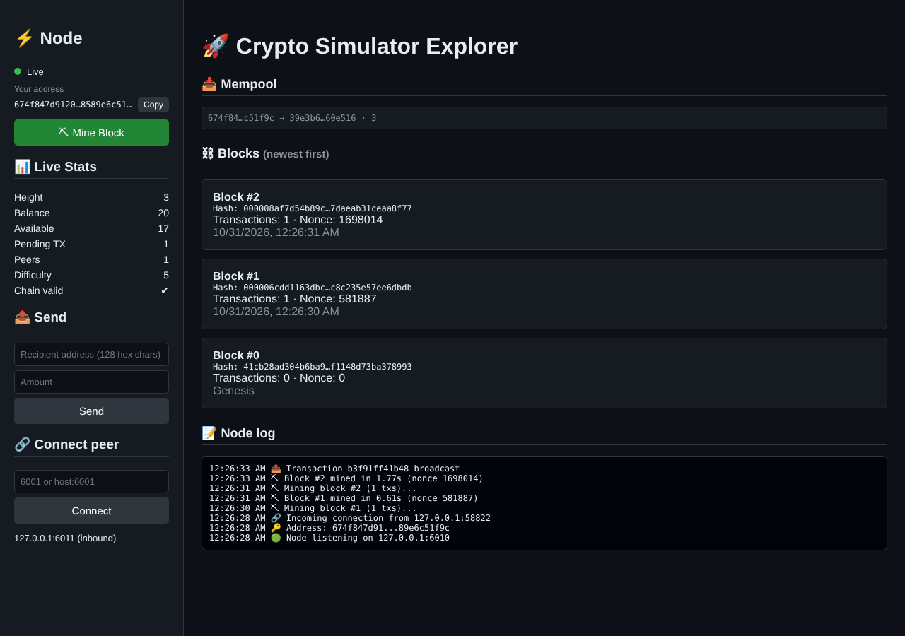

<p align="center">
  
</p>

<p align="center">
  
  
  
  
  
  
</p>

# 🚀 Crypto Simulator

An educational blockchain built from first principles in Python: signed transactions, an account-based ledger with balance checks, Proof-of-Work mining, gossip-based peer-to-peer networking with longest-chain consensus, and a live web dashboard.

Several nodes can run on one machine, exchange transactions, mine competing blocks, and converge on the same chain.



## ⚙️ How it works

```text
Wallet (secp256k1 keys)
   │  sign
   ▼
Transaction ──gossip──► peers
   │  signature, balance, replay checks
   ▼
Mempool
   │  build candidate block (coinbase + valid txs)
   ▼
Proof-of-Work (runs off the event loop, aborts if a new tip arrives)
   │
   ▼
Block ──gossip──► peers ──► validate ──► append, or request chain and adopt longest valid one
```

### Ledger rules

- **Genesis** is deterministic, so every node starts from the same block.
- **Transactions** carry a timestamp and a random nonce. The signed hash covers sender, recipient, amount, timestamp and nonce, so a captured transaction can't be replayed or altered.
- **Addresses** are uncompressed secp256k1 public keys (128 hex chars). Malformed recipients are rejected so coins can't be sent into the void.
- **Amounts** must be finite and positive. A sender can't spend more than their confirmed balance minus what they already have in the mempool.
- **Coinbase**: exactly one per block, in first position, paying exactly the mining reward. Peers can't inject coinbase transactions.
- **Blocks** are checked for index, `previous_hash`, recomputed hash, required difficulty, transaction validity, duplicates and sufficient balances.
- **Fork choice**: a node adopts a received chain only if it is longer and fully valid from genesis. Transactions from orphaned blocks go back into the mempool when still valid.

### Networking

- Newline-delimited JSON over asyncio TCP.
- On connect, both sides exchange a `hello` and a `get_chain`, so a new node syncs immediately.
- New transactions and blocks are relayed to every other peer (gossip), so nodes don't need direct connections to each other.
- A block that's ahead of local state or on a fork triggers a chain request to the sender.

## ▶️ Quick start

```bash
python -m venv venv
source venv/bin/activate
pip install -r requirements.txt
```

### Web dashboard

Run two nodes in two terminals:

```bash
python api.py --api-port 5000 --p2p-port 6000
```

```bash
python api.py --api-port 5001 --p2p-port 6001 --peer 6000
```

Open http://127.0.0.1:5000 and http://127.0.0.1:5001. Mine on one, copy the other node's address, send it coins, and mine again.

### CLI

```bash
python app.py --port 7000
```

```bash
python app.py --port 7001 --peer 7000
```

| Command | Description |
|---|---|
| `connect <port>` / `connect <host:port>` | Connect to a peer |
| `send <recipient> <amount>` | Sign, add to mempool and broadcast |
| `sendraw <recipient> <amount>` | Sign and add to local mempool only |
| `broadcast` | Broadcast all pending transactions |
| `mine` | Mine a block |
| `balance [address]` | Confirmed and available balance |
| `chain` / `validate` | Height and full validation |
| `blocks [n]` / `block <index>` | List blocks / show one as JSON |
| `txpool` / `peers` / `state` / `address` | Inspect node state |
| `sync` | Request chains from all peers |
| `exit` | Quit |

Options for both entry points: `--host`, `--peer` (repeatable), `--difficulty` (leading hex zeros, default 5).

### REST API

| Method | Path | Description |
|---|---|---|
| GET | `/state` | Node summary |
| GET | `/chain` | Full chain and validity |
| GET | `/blocks/{index}` | Single block |
| GET | `/transactions/{id}` | Transaction status (pending / confirmed) |
| GET | `/balance?address=` | Balance (defaults to this node) |
| GET | `/pending`, `/peers`, `/address`, `/events` | Mempool, peers, address, log |
| POST | `/mine` | Mine a block |
| POST | `/transactions` | `{"recipient": "...", "amount": 1.5}` |
| POST | `/peers` | `{"host": "127.0.0.1", "port": 6001}` |
| WS | `/ws` | Live dashboard feed |

Interactive docs at `/docs`.

## 🧪 Tests

```bash
pip install -r requirements-dev.txt
pytest -q
```

The suite covers ledger rules (forged coinbase, overspend, replay, bad signatures, tampering, wrong reward), multi-node sync, relay through intermediate peers, fork resolution, and the HTTP/WebSocket API.

## 🗂 Project layout

```text
blockchain/   transaction, block, PoW, chain validation, wallet
network/      TCP peer layer and node logic
api.py        FastAPI server + dashboard
app.py        interactive CLI node
dashboard/    static front end
tests/        pytest suite
```

## 🚧 Limitations

This is a teaching simulator, not a cryptocurrency.

- State is in memory: wallets and chains are lost when a node stops.
- Account model rather than UTXO.
- Fixed difficulty, no retargeting; fork choice compares chain length.
- Manual peer connection, no discovery, no peer authentication or DoS protection.
- Full chain is sent on every sync.
- Amounts are floats rounded to 8 decimals.
- No smart contracts.

## 📄 Version history

- **v1.0.0**: ledger validation, chain sync and fork resolution, gossip relay, working CLI and dashboard, test suite.
- **v0.1**: initial prototype.
